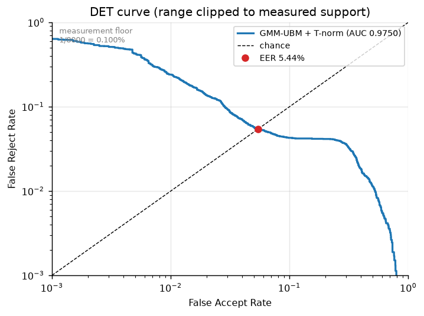
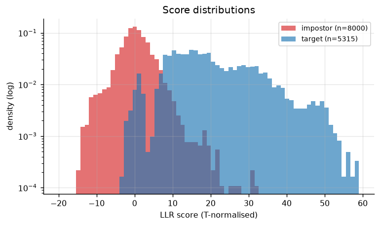
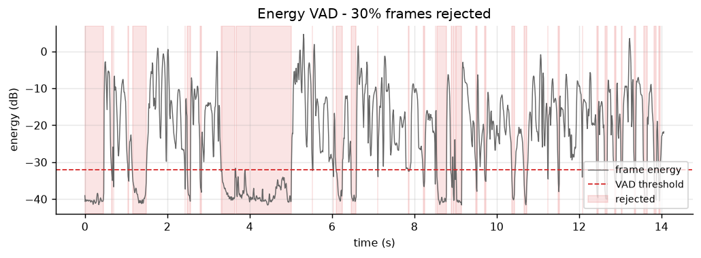

# Voice Authentication

Text-independent speaker verification using a Gaussian mixture model with a
universal background model (GMM-UBM), per-speaker Bayesian adaptation, and
score normalisation.

Given an enrollment recording and a test recording, the system answers one
question: **is this the same speaker?**

## Result

| Metric | Value |
|---|---|
| **EER** | **5.42%** (95% CI 3.32–7.68%) |
| **minDCF** (p=0.01, normalised) | **0.720** |
| **AUC** | **0.975** |
| Trials | 5,315 target / 8,000 impostor |
| Speakers | 50 (held out from UBM training) |
| Conditions | Clean read speech, channel-matched |

Confidence interval from 1,000 **speaker-clustered** bootstrap resamples —
resampling speakers, not individual trials, because trials sharing a speaker
are correlated.

### Read this before quoting the number

**5.42% is per single utterance.** An earlier run of this project reported
0.43%; that figure averaged three test utterances per trial, which is an
ensemble and cancels per-utterance variance. It is not comparable and is not
the headline. The contrast is itself the finding: score averaging across three
recordings buys roughly an order of magnitude in EER, which tells you how much
of the remaining error is utterance-level noise rather than speaker confusion.

**The channel-matched caveat matters more than the EER.** LibriSpeech is clean
read audiobook speech, all recorded with similar equipment. Classic GMM-UBM
degrades sharply under handset or far-field mismatch — published evaluations
on telephone data show several times this error rate. Do not carry 5.42% to a
real deployment without re-measuring on your own audio.

## Figures

| | |
|---|---|
|  |  |
| Detection error tradeoff | Target vs impostor scores |
|  |  |
| Per-speaker separation margin | Detection cost vs threshold |
|  |  |
| Cepstra and deltas | Energy VAD |

All ten live in [`figures/`](figures/), regenerate with
`py scripts/make_figures.py`.

## Method

```
waveform
  └─ 20 ms frames / 10 ms hop
     └─ pre-emphasis → Hamming → FFT → 40-band mel → log → DCT
        └─ 19 cepstra (c0 dropped) + 19 first-order deltas over ±2 frames
           └─ energy VAD (drops ~30% of frames)
              └─ 38-D feature vector per frame

background speakers ──→ UBM (256 diagonal Gaussians, EM)
                                    │
                            MAP adaptation (r=16, means only)
                                    │
                         per-speaker GMM
                                    │
                 score = log p(x│speaker) − log p(x│UBM)
                                    │
                         T-norm (per-model imposter cohort)
                                    │
                            threshold → accept / reject
```

The design follows the GMM-UBM approach established in the NIST Speaker
Recognition Evaluation era (2000–2004). Deviations from the canonical
configuration are listed honestly:

| Component | Canonical | This build | Why |
|---|---|---|---|
| Mixtures | 1024 | 256 | CPU-only; `N_MIXTURES` is the knob |
| Normalisation | handset-dependent | T-norm | no handset labels in LibriSpeech |
| Adaptation | means only, r=16 | same | — |
| Features | mel-cepstrum + deltas | same | — |

## Install

```bash
py -m pip install -r requirements.txt
```

Requires Python 3.10+. No GPU needed at 256 mixtures.

## Pipeline

```bash
py scripts/download_data.py      # ~6.4 GB LibriSpeech train-clean-100 (parquet)
py scripts/train_ubm.py          # ~30 min: features + UBM training
py scripts/extract_features.py   # ~4 min: held-out eval speakers
py scripts/evaluate.py           # ~12 min: enroll, score, T-norm, EER + CI
py scripts/make_figures.py       # ~1 min: all ten figures
```

Every step is idempotent — cached features are reused on re-run.

## Layout

```
voice_auth/
├── src/voiceauth/          library
│   ├── config.py           every tunable, resolved from the repo root
│   ├── features.py         MFCC, deltas, VAD
│   ├── gmm_ubm.py          EM, MAP adaptation, scoring
│   └── dataset.py          parquet indexing with row-group cache
├── scripts/                pipeline entry points
├── tests/                  12 checks, `py -m pytest tests/ -q`
├── figures/                generated, not hand-drawn
├── docs/                   methodology notes
├── data/raw/               6.4 GB parquet — delete to reclaim space
├── data/features/          cached .npy (26k files)
├── models/                 ubm.pkl, speaker_split.pkl
└── outputs/                scores.npz, report.txt, logs
```

## Tuning

| Want | Change |
|---|---|
| More mixtures | `N_MIXTURES` in config, delete `models/ubm.pkl`, rerun steps 2 and 4 |
| Faster UBM | lower `UBM_MAX_FRAMES` |
| Less RAM | lower `UBM_FRAME_CHUNK` (keeps the 400 MB floor) |
| No normalisation | `T_NORM_ENABLED = False` |
| All utterances as test | already default (`UTTS_PER_SPK_TEST = 999`) |

## Limitations

- **50 speakers.** EER resolution is bounded by speaker count, not trial count.
- **Clean audio only.** No channel or noise compensation beyond T-norm.
- **No anti-spoofing.** A recording of the target's voice passes. This is a
  verifier, not a liveness detector.
- **T-norm cohort overlaps eval data.** The cohort is drawn from test
  utterances, which is mildly optimistic. A disjoint cohort would be stricter.

## License

MIT — see [LICENSE](LICENSE).
