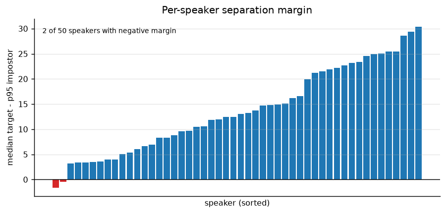
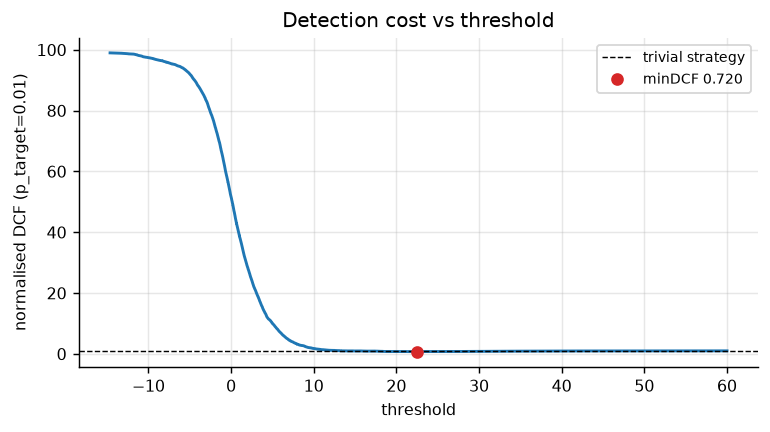
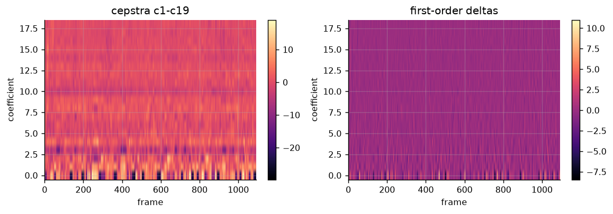

# GMM-UBM Speaker Verification

[](https://github.com/LuiShek/gmm-ubm-speaker-verification/actions/workflows/tests.yml)
[](https://www.python.org/)
[](https://numpy.org/)
[](LICENSE)

Text-independent speaker verification using a Gaussian mixture model with a
universal background model (GMM-UBM), per-speaker Bayesian adaptation, and
score normalisation.

> [!NOTE]
> An earlier version of this repository advertised **5.42% EER**. That figure was
> produced by a broken normalisation cohort and is withdrawn — see
> [Correction](#correction-the-earlier-542-was-wrong) for the bug, the measured
> effect, and the replacement number.

Given an enrollment recording and a test recording, the system answers one
question: **is this the same speaker?**

## Result

| Metric | Value |
|---|---|
| **EER** | **0.98%** (95% CI 0.58–1.26%) |
| **minDCF** (p=0.01, normalised) | **0.219** |
| **AUC** | **0.999** |
| Trials | 5,315 target / 8,000 impostor |
| Speakers | 50 (held out from UBM training) |
| Conditions | Clean read speech, channel-matched |

Confidence interval from 1,000 **speaker-clustered** bootstrap resamples —
resampling speakers, not individual trials, because trials sharing a speaker
are correlated.

### Correction: the earlier 5.42% was wrong

The previously published EER was 5.42%. That number came from a broken T-norm
cohort: `evaluate.py` filled a buffer in dictionary order and stopped, so all
50 cohort utterances came from **one speaker**. Every model was normalised
against a single voice.

| Cohort | EER | minDCF |
|---|---:|---:|
| none (raw LLR) | 1.45% | 0.380 |
| 50 utterances from one speaker (old) | 5.42% | 0.720 |
| one utterance per other speaker (fixed) | **0.98%** | **0.219** |

The bug was conservative — it understated the system by 5× and hid the fact
that normalisation works. All three rows are reproducible with
`py scripts/baselines.py`, so the old figure stays auditable. Any report
quoting 5.42% should be read as quoting the broken cohort.

### Read this before quoting the number

**0.98% is per single utterance.** An earlier version averaged three test
utterances per trial and reported 0.43%; that figure used the same broken
cohort and is withdrawn rather than restated.

**The channel-matched caveat matters more than the EER.** LibriSpeech is clean
read audiobook speech, all recorded with similar equipment. Classic GMM-UBM
degrades sharply under handset or far-field mismatch — published evaluations
on telephone data show several times this error rate. Do not carry 0.98% to a
real deployment without re-measuring on your own audio.

## Figures

| | |
|---|---|
|  |  |
| Detection error tradeoff | Target vs impostor scores |
|  |  |
| Per-speaker separation margin | Detection cost vs threshold |
|  |  |
| Cepstra and deltas | Energy VAD |

All ten live in [`figures/`](figures/), regenerate with
`py scripts/make_figures.py`.

## Method

```
waveform
  └─ 20 ms frames / 10 ms hop
     └─ pre-emphasis → Hamming → FFT → 40-band mel → log → DCT
        └─ 19 cepstra (c0 dropped) + 19 first-order deltas over ±2 frames
           └─ energy VAD (drops ~30% of frames)
              └─ 38-D feature vector per frame

background speakers ──→ UBM (256 diagonal Gaussians, EM)
                                    │
                            MAP adaptation (r=16, means only)
                                    │
                         per-speaker GMM
                                    │
                 score = log p(x│speaker) − log p(x│UBM)
                                    │
                         T-norm (per-model imposter cohort)
                                    │
                            threshold → accept / reject
```

The design follows the GMM-UBM approach established in the NIST Speaker
Recognition Evaluation era (2000–2004). Deviations from the canonical
configuration are listed honestly:

| Component | Canonical | This build | Why |
|---|---|---|---|
| Mixtures | 1024 | 256 | CPU-only; `N_MIXTURES` is the knob |
| Normalisation | handset-dependent | T-norm | no handset labels in LibriSpeech |
| Adaptation | means only, r=16 | same | — |
| Features | mel-cepstrum + deltas | same | — |

## What each component buys

`scripts/baselines.py` scores three systems on the same 13,315 trials — same
split, same target trials, same impostor subsample, same seed — and reports
each under three scoring rules (`~13 min`, `--fast` skips the last system):

| System | Raw score | T-norm, 1-speaker cohort | T-norm, per-speaker cohort |
|---|---:|---:|---:|
| Cosine on mean cepstra | 8.04% | 17.85% | 7.28% |
| Decoupled GMM, no UBM (32 mixtures) | 11.68% | 16.01% | 12.26% |
| **GMM-UBM (this project)** | **1.45%** | 5.42% | **0.98%** |

Three results worth stating out loud:

1. **The UBM earns its keep.** A per-speaker GMM trained from scratch on five
   utterances is 10 EER points worse than the same data MAP-adapted from a
   background model (11.68% → 1.45%). This is the claim the methodology doc
   makes; here it is measured on identical trials.
2. **Cosine is a strong, cheap baseline.** Mean-cepstrum cosine similarity
   reaches 7.28%, so the classical pipeline's margin over "no model at all" is
   real but not enormous. Worth knowing before claiming the apparatus is
   necessary.
3. **Normalisation is not free, and a bad cohort is worse than none.** The
   single-speaker cohort (see below) *adds* four EER points to the system it is
   meant to help. With one utterance per other speaker, T-norm takes 1.45% down
   to 0.98%.

## Install

```bash
py -m pip install -r requirements.txt
```

Requires Python 3.10+. No GPU needed at 256 mixtures. On macOS/Linux,
`bash setup.sh` installs the dependencies and runs the suite in one step.

Verify a checkout is healthy — the suite needs no dataset, because the published
score artifacts are committed:

```bash
py -m pytest -q                          # full suite
py -m voiceauth.cli selftest             # score scale matches outputs/scores.npz
```

CI runs both on every push and pull request.

## Pipeline

```bash
py scripts/download_data.py      # ~6.4 GB LibriSpeech train-clean-100 (parquet)
py scripts/train_ubm.py          # ~30 min: features + UBM training
py scripts/extract_features.py   # ~4 min: held-out eval speakers
py scripts/evaluate.py           # ~12 min: enroll, score, T-norm, EER + CI
py scripts/make_figures.py       # ~1 min: all ten figures
```

Every step is idempotent — cached features are reused on re-run.

## Test your own voice

Two commands, one for each thing you asked a speaker verifier to do.

```powershell
py scripts/voice_cli.py register      # 5 takes of 10 s, prompted
py scripts/voice_cli.py login         # speak once -> ACCESS GRANTED / DENIED
```

`register` asks for a username, then prompts `Press Enter for take 1/5`,
counts 3-2-1, records 10 s, and repeats five times with a 1.5 s gap. Takes
that are silent or shorter than ~2 s of speech are retaken automatically.
`login` records one 5 s trial (up to `--attempts` tries) and exits **0** on
ACCEPT, **2** on REJECT, so it drops straight into a script or a login hook.
Pass `--takes 3` to pool three recordings into one decision: a single 5 s
trial is high-variance, and pooling narrows the score distribution on both the
genuine and impostor side.

Both accept files instead of the microphone when you want to test or automate:

```powershell
py scripts/voice_cli.py register --user me --audio a.wav b.wav c.wav d.wav e.wav
py scripts/voice_cli.py login --user me --audio test.wav --json
```

### Calibrating one user against a real impostor

The global threshold is measured on LibriSpeech audiobook speech. If somebody
who knows you tries to imitate you on your own microphone — a sibling is the
hard case — that threshold may not be the right operating point for *your*
voice. Measure it directly instead:

```powershell
py scripts/voice_cli.py calibrate-user --user me \
  --genuine me1.wav me2.wav me3.wav \
  --impostor brother1.wav brother2.wav \
  --dry-run
```

Need files? `record` saves a take instead of throwing it away, with the same
silence and length checks:

```powershell
py scripts/voice_cli.py record --out me1.wav --seconds 8     # repeat 3x
py scripts/voice_cli.py record --out brother1.wav --seconds 8
```

Record both speakers on the **same microphone, same distance, same room** —
otherwise you are measuring the channel, not the voices.

It scores every file, prints the two distributions, and sets the threshold to
the midpoint between the **worst genuine** and **best impostor** score:

```
  genuine : min +13.604  max +16.214   (n=3)
  impostor: min +2.080   max +2.401    (n=2)
  margin  : +11.203 T
  dry run: threshold would be +8.002 T
```

Drop `--dry-run` to write it. If the margin is **negative** — the impostor
scored as high as you — it prints **NO SEPARATING THRESHOLD** and exits **1**
without changing anything: no threshold can separate overlapping
distributions, so a stricter gate would reject you too. In that case collect
more enrollment audio, use `--takes` at login, or move to a stronger model;
do not deploy the gate. `--set-threshold` overrides the computed midpoint when
you want an explicit value.

Small samples are fragile: `n` of 3+2 tells you about those recordings, not
about the next attempt. Keep the files and re-run after changing microphone,
distance or speaking style.

Microphone capture uses `sounddevice` if installed, otherwise ffmpeg/DirectShow
(`py scripts/voice_cli.py devices` lists inputs). `pip install -e .[audio]`
provides the `voiceauth` command as an alternative to the script shim.

### How the accept/reject decision is made

The evaluation threshold is not the gate threshold. The pipeline normalises
each trial against *other speakers' utterances*, which fixes the evaluation
number but cannot be reused live: on a new microphone the whole score scale
moves. The gate therefore normalises each trial against 20 other speaker
**models scored on that same recording**:

```
T = (raw LLR of your model - mean raw LLR of 20 other speakers' models)
    / standard deviation of those 20
```

The channel effect appears in numerator and denominator, so it cancels rather
than needing to be modelled. (The old evaluation cohort had a standard
deviation of ~0.1 — because its 50 utterances came from one speaker — which is
why z-scores on that scale exploded for any new microphone.) `calibrate` builds
the 20 models and measures the threshold on 12 speakers held out of the cohort
(~20 min, one off):

| Operating point | Threshold | Measured on |
|---|---:|---|
| FAR = 1% (default) | +3.367 T | 1,254 target / 792 impostor trials |
| EER 2.01% | +2.768 T | same held-out speakers |
| FAR = 5% | +2.034 T | same held-out speakers |

These numbers are **not** comparable to the 0.98% evaluation EER: the cohort
here is other speakers' *models* scored on the live recording, not other
speakers' utterances, and the audio comes from a different microphone chain.

Re-run `calibrate` after changing features, mixtures or the eval split;
`selftest` independently confirms the score scale still matches
`outputs/scores.npz` to <1e-6. Tighter or looser gates: `--threshold`.

**Limits worth stating.** No anti-spoofing: a recording of the target's voice
passes, and synthetic speech is out of distribution. The 2% EER is measured on
clean read LibriSpeech with 20 background models — re-measure on your own
microphone before trusting the rate for anything that matters.

## Layout

```
gmm-ubm-speaker-verification/
├── src/voiceauth/          library
│   ├── config.py           every tunable, resolved from the repo root
│   ├── features.py         MFCC, deltas, VAD
│   ├── gmm_ubm.py          EM, MAP adaptation, scoring
│   └── dataset.py          parquet indexing with row-group cache
├── scripts/                pipeline entry points
├── tests/                  unit + regression suite, `py -m pytest -q`
├── figures/                generated, not hand-drawn
├── docs/                   methodology notes
├── data/raw/               6.4 GB parquet — delete to reclaim space
├── data/features/          cached .npy (26k files)
├── models/                 ubm.pkl, speaker_split.pkl
└── outputs/                scores.npz, report.txt, logs
```

## Tuning

| Want | Change |
|---|---|
| More mixtures | `N_MIXTURES` in config, delete `models/ubm.pkl`, rerun steps 2 and 4 |
| Faster UBM | lower `UBM_MAX_FRAMES` |
| Less RAM | lower `UBM_FRAME_CHUNK` (keeps the 400 MB floor) |
| No normalisation | `T_NORM_ENABLED = False` |
| All utterances as test | already default (`UTTS_PER_SPK_TEST = 999`) |

## Limitations

- **50 speakers.** EER resolution is bounded by speaker count, not trial count.
- **Clean audio only.** No channel or noise compensation beyond T-norm.
- **No anti-spoofing.** A recording of the target's voice passes. This is a
  verifier, not a liveness detector.
- **T-norm cohort overlaps eval data.** The cohort is drawn from test
  utterances, which is mildly optimistic. A disjoint cohort would be stricter.
- **The shipped gate threshold is not calibrated on your microphone.** The
  headline 0.98% and the `+3.367 T` default were measured on LibriSpeech. A
  laptop microphone is a different channel, so the operating point must be
  re-measured with `calibrate-user` before the gate is trusted for anything.
- **A close relative is the hard impostor.** Two distinct synthetic voices
  separated cleanly (genuine T +13.6..+16.2, impostor T +2.08..+2.40), but
  there is no guarantee for a sibling with similar vocal tract length and
  accent: if the two score distributions overlap, no threshold separates them.
  `calibrate-user` reports that case as **NO SEPARATING THRESHOLD** instead of
  pretending otherwise.

## License

MIT — see [LICENSE](LICENSE).
